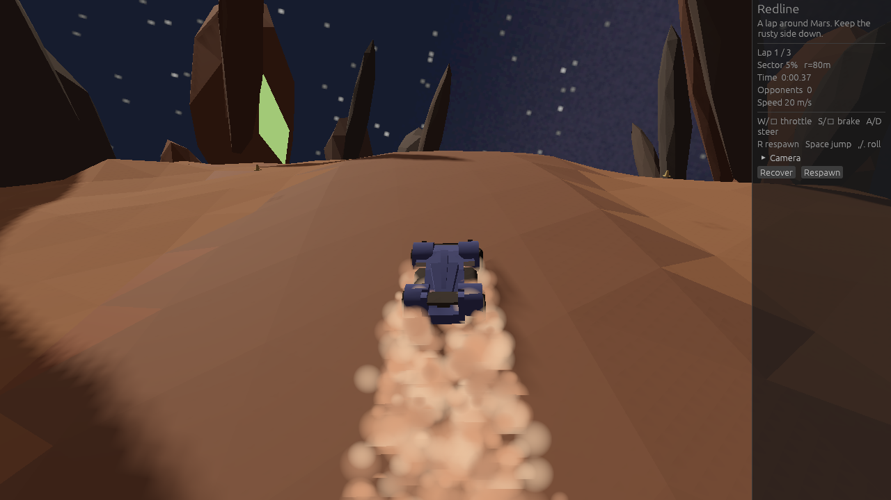

# Redline

Original futuristic planet-circuit racing (F-Zero / Wipeout energy). Physics-first
ribbon racing on procedurally generated worlds — Mars is the flagship circuit.

See [docs/DESIGN.md](docs/DESIGN.md) for the north star.

Play in the browser: <https://kvark.github.io/redline/>



## Run

Models are stored in Git LFS:

```sh
git lfs install
git lfs pull
cargo run --release
```

Interactive runs open a pre-race egui menu to pick a craft and circuit; Enter
Circuit runs a 3-2-1-GO start, then the lap. `--script` / `--smoke` (and WASM
query scripts) skip the menu and countdown and boot straight into the drive.

The vehicle is a Rapier joint graph (chassis, four wheels, suspenders). Debug
builds of that solver are much slower than `--release`; use release for playable
framerate.

Optional ray-traced lighting (needs RT hardware):

```sh
REDLINE_RT=1 cargo run --release
```

Headless smoke test (used by Linux CI):

```sh
# debug — catches assertion failures that --release strips
xvfb-run -a cargo run -- --smoke 20
xvfb-run -a cargo run --release -- --smoke 20
```

Scripted drive traces (writes CSV and a log summary, then exits):

```sh
xvfb-run -a cargo run --release -- --script accel --seconds 8
xvfb-run -a cargo run --release -- --script steer --seconds 8
xvfb-run -a cargo run --release -- --script offroad --seconds 12
xvfb-run -a cargo run --release -- --script lap --seconds 12 --record /tmp/redline-lap.csv
xvfb-run -a cargo run --release -- --script race --seconds 120 --record /tmp/redline-race.csv
```

Scripts: `accel` (straight throttle), `steer` (hold left), `offroad` (leave the ribbon then return), `lap` (follow the track until a lap completes, no AI), `race` (same driving with AI opponents through 3 laps / `laps_to_win`). Default CSV path is `/tmp/redline-<script>.csv`.

Physics uses a fixed 10 ms step with catch-up so lavapipe, a real GPU, and WebGL2 share the same controls/joints regardless of frame time. Scripted runs catch up aggressively so a full lap finishes in seconds of wall time under software raster.

Boost pads: each timed sector after the launch has a glowing chevron strip on
the straightest part of the ribbon. Rolling onto one fires a short forward thrust
through the chassis rigid body (with a cooldown), stacking with the
scrub→rejoin boost under a shared cap. Player, AI, and scripted drives all use
it. The chase camera widens its FOV with speed and boost, speed lines streak
past while boosting, and the HUD flashes `» BOOST «`. Script runs log
`pad_hits=<player>/<pads>` and the trace summary counts `pad_hits`.

On the web build, the same scripts are available via query string, e.g. `?script=lap&seconds=45` or `?script=race&seconds=120`.

Race audio (engine pitch with speed, boost whooshes, start-light beeps and a
GO chord) is synthesized in code on both builds. Native streams it to the
default device (`REDLINE_MUTE=1` to silence); the web build plays it through
Web Audio, which browsers unlock on the first click or key press (`?mute=1` to
silence). With no device or no working `AudioContext`, the race runs silently.

Best-lap ghost: every line-to-line lap is recorded at 20 Hz (position,
orientation, boost). When a race finishes, the fastest lap is kept only if it
beats the saved ghost for that circuit, and the next race replays it as a cyan
hologram craft (an open emissive lattice plus a faint particle haze; it has no
collider, so it never touches the physics). The HUD shows `+0.4s vs ghost`
(behind) or `-0.3s vs ghost` (ahead) and the ghost's lap time. Ghosts are saved
per circuit to `ghost-<circuit>.ron` in `$REDLINE_GHOST_DIR`, else
`$XDG_DATA_HOME/redline`, `~/.local/share/redline` or `%APPDATA%\redline`;
delete that file (e.g. `rm ~/.local/share/redline/ghost-mars-equator.ron`) to
clear it. Scripted runs and `--smoke` skip ghosts unless `REDLINE_GHOST_DIR` is
set, so CI never sees a player's saved lap. The web build keeps the ghost for
the browser session only.

Championship: the menu's Championship entry runs three races on Mars Equator
with points by finishing order, 10-6-4-3 for P1-P4 (whoever is classified at
the player's finish; the web build's two AI included). Ties on points go to the
better best race finish, then the faster best lap. The results board shows the
running standings, this race's points and race N of 3; its Next Race button
(Enter) starts the next race, and after race 3 it crowns the champion and
offers New Championship. Standings persist in `championship-mars-equator.ron`
next to the ghosts (web: localStorage `redline:championship-mars-equator`), so
quitting mid-way resumes at the same race. Reset Championship in the menu
deletes the save and zeroes the points. Bad or foreign saves are skipped with a
warning. Scripted runs and `--smoke` never touch it unless `--championship`
(web: `?championship=1`) is passed, which also scores the scripted race and
holds for the results board.

## Web / WASM

Requires a WebGL2 browser. Assets are embedded at compile time. `.cargo/config.toml`
sets `--cfg gles` for `wasm32`, which Blade needs so the shadow pipeline includes
a fragment shader (WebGL cannot link a vertex-only program).

```sh
rustup target add wasm32-unknown-unknown
cargo install wasm-bindgen-cli
cargo build --release --target wasm32-unknown-unknown
wasm-bindgen --target web --no-typescript --out-dir dist/pkg \
    target/wasm32-unknown-unknown/release/redline.wasm
cp web/index.html dist/index.html
python3 -m http.server --directory dist
```

Pushes to `main` build the WASM target and deploy it to GitHub Pages.

Controls: `W/↑` throttle, `S/↓` brake, `A/D` steer, `R` respawn, `Space` jump, `,/.` roll, `P` pause/resume, `Esc` opens the menu while racing (quit from the menu on native).

The heading-up HUD map shows the cyan ribbon and its racing direction, your white
craft marker, and the next required gate in yellow. Gates outside the local map
stay visible as a border arrow; the bearing label also identifies missed gates
behind you. An orange marker points back to the ribbon when off course. Guidance
is visual only; steering and throttle remain entirely manual.

Kenney models are CC0; licenses are in `assets/licenses/`. Generated planet meshes go to `assets/generated/` and are not committed. Render WGSL comes from `blade_render::shader_dir()` (packaged in `blade-render`; see [blade#391](https://github.com/kvark/blade/pull/391)) — not vendored under `assets/`.
